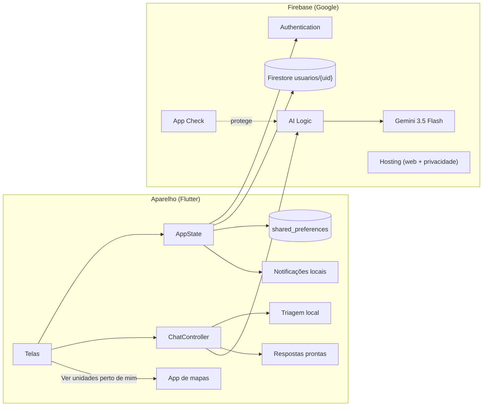

# CuidaIA: documentação técnica completa

**Versão do app:** 1.0.0 (build 1)
**Autor:** Zairo Lins Ribeiro Cunha
**Contexto:** Trabalho de Conclusão de Curso (Unitins)
**Última atualização:** novembro de 2026

Este documento descreve o CuidaIA por inteiro: o que ele faz, as tecnologias
usadas e o motivo de cada escolha, como o código está organizado e a função de
cada arquivo, classe e função. Ele é escrito para a banca examinadora e para
quem for manter ou estudar o código.

---

## Sumário

1. [Visão geral](#1-visão-geral)
2. [Funcionalidades](#2-funcionalidades)
3. [Tecnologias e justificativas](#3-tecnologias-e-justificativas)
4. [Arquitetura](#4-arquitetura)
5. [Estrutura de pastas](#5-estrutura-de-pastas)
6. [Documentação do código, arquivo por arquivo](#6-documentação-do-código-arquivo-por-arquivo)
7. [Fluxos principais](#7-fluxos-principais)
8. [O assistente de IA em detalhe](#8-o-assistente-de-ia-em-detalhe)
9. [Dados pessoais e LGPD](#9-dados-pessoais-e-lgpd)
10. [Segurança](#10-segurança)
11. [Acessibilidade](#11-acessibilidade)
12. [Identidade visual](#12-identidade-visual)
13. [Testes automatizados](#13-testes-automatizados)
14. [Avaliação da classificação orientativa](#14-avaliação-da-classificação-orientativa)
15. [Como executar, compilar e publicar](#15-como-executar-compilar-e-publicar)
16. [Limitações e trabalhos futuros](#16-limitações-e-trabalhos-futuros)
17. [Glossário](#17-glossário)

---

## 1. Visão geral

### 1.1 O problema

Muita gente não sabe como o Sistema Único de Saúde (SUS) se organiza nem onde
procurar atendimento para cada situação. A pessoa vai ao pronto-socorro por um
problema que a Unidade Básica de Saúde (UBS) resolveria, ou espera em casa numa
situação que exigia ligar para o SAMU. As informações oficiais existem, mas
ficam espalhadas em portarias e portais escritos em linguagem técnica.

### 1.2 A proposta

O CuidaIA é um aplicativo de **educação em saúde** que explica o SUS em
linguagem simples e **orienta** em qual nível de atenção a pessoa deve buscar
atendimento. Ele combina três recursos:

- **Conteúdos revisados** sobre a Rede de Atenção à Saúde (RAS) e os níveis de
  atenção: primária, secundária e terciária;
- um **assistente com inteligência artificial** (Gemini, do Google), que
  responde dúvidas e sugere o tipo de serviço adequado, sempre citando uma fonte
  oficial;
- uma **triagem local de risco**, que reconhece situações de emergência e
  manda direto para o SAMU 192 ou o CVV 188, sem depender da IA.

### 1.3 O que o app não faz

O CuidaIA **não faz diagnóstico**, não indica remédios ou tratamentos e não
substitui o atendimento profissional. Essa regra está:

- na instrução dada à IA;
- nos textos das telas ("Orienta, não diagnostica", "Não é diagnóstico");
- nos Termos de uso.

### 1.4 Público

Pessoas adultas usuárias do SUS, inclusive com pouca familiaridade com
tecnologia ou com o tema. Por isso o app oferece:

- linguagem simples;
- ajuste do tamanho do texto;
- alto contraste;
- fonte de leitura facilitada;
- leitura em voz alta das respostas.

---

## 2. Funcionalidades

### 2.1 Conta

| Função | Descrição |
|---|---|
| Criar conta | Nome completo, e-mail e senha (mínimo de 8 caracteres, com letra e número). Envia um e-mail de confirmação. |
| Confirmar o e-mail | Quem cria a conta com e-mail e senha só entra no app depois de abrir o link de confirmação. Até lá, vê a tela "Confirme seu e-mail", com "Já confirmei", "Reenviar o link" (um envio por minuto) e "Sair e usar outra conta". Contas Google já vêm confirmadas. |
| Entrar com e-mail e senha | Login tradicional, com mensagens de erro em linguagem simples. |
| Continuar com o Google | Login com a conta Google. Na primeira vez, o perfil é criado com o nome e o e-mail do Google. |
| Esqueci minha senha | Envia um link de redefinição para o e-mail digitado. O app não informa se o e-mail tem conta, para não expor quem usa o app. |
| Sessão salva | Quem já entrou abre o app direto na tela inicial (ou na confirmação do e-mail, se ela ainda falta). |
| Editar perfil | Nome, apelido, e-mail e foto. A troca de e-mail só vale depois que a pessoa confirma o link enviado ao novo endereço. |
| Alterar senha | Exige a senha atual. Não aparece para quem entrou pelo Google. |
| Sair | Encerra a sessão, apaga a conversa e cancela as notificações. |
| Excluir conta | Pede a senha (ou uma nova confirmação com o Google) e apaga o login, o perfil e os dados guardados no aparelho. |

### 2.2 Início

- Saudação com o primeiro nome ou o apelido.
- Campo "Pergunte sobre o SUS…", que abre o assistente.
- Atalhos:
  - **Onde ser atendido** abre o fluxo de orientação no chat;
  - **Emergência 192** abre o discador.
- **Continue lendo:** mostra o último artigo aberto e quanto dele já foi lido.
  Quem ainda não abriu nenhum artigo vê "Comece por aqui".
- Lista numerada dos níveis de atenção, com link para cada artigo.
- Botão de notificações.

### 2.3 Assistente (chat)

- Perguntas livres em texto.
- **Perguntas frequentes** com respostas prontas e revisadas. Elas não gastam
  a cota da IA.
- **"Onde devo ser atendido?":** a pessoa escolhe entre quatro situações
  (risco à vida, atendimento hoje, pode esperar, sofrimento emocional) e
  recebe o serviço indicado.
- **Triagem de risco:** frases como "dor no peito" ou "não quero mais viver"
  mostram na hora o SAMU 192 ou o CVV 188.
- **Resposta da IA** com o selo "Resposta gerada por IA" e um bloco "Fonte
  oficial" com link para o documento.
- **Sugestão de serviço:** quando a pessoa descreve uma situação, a IA indica o
  nível de atenção, com uma justificativa curta.
  - O cartão traz o que levar e como chegar.
  - O botão **"Ver unidades perto de mim"** abre o app de mapas do celular
    buscando o tipo de unidade (UBS, UPA ou CAPS).
  - Há também "Saber mais sobre este nível" e "Não é bem isso? Ver outras
    opções".
- **Pergunta de esclarecimento:** se o relato for curto demais para escolher o
  nível e não houver sinal de risco, a IA faz uma única pergunta (por exemplo,
  há quanto tempo começou) antes de sugerir o serviço. As opções manuais de
  "Onde devo ser atendido?" continuam à mão.
- **Ouvir:** cada resposta pode ser lida em voz alta.
- **Erros:** "Sem conexão" ou "O assistente não respondeu agora", com o botão
  "Tentar novamente". A pergunta fica salva.
- **Apagar conversa:** limpa o histórico, que fica só no aparelho.

### 2.4 Aprenda

- **Diagrama da Rede de Atenção à Saúde.**
- **Níveis de atenção numerados**, cada um com um resumo.
- **"Como se conectam":** linha do tempo com encaminhamento, regulação,
  retorno (contrarreferência) e urgência.
- **"Exemplo de percurso":** a história de um usuário passando pelos níveis.
- **"Saúde coletiva":** link para o artigo de vigilância em saúde (vacinação,
  controle de doenças e fiscalização).
- **Fontes oficiais**, em chips com links.
- **Busca nos conteúdos.**
- **Data da última revisão** dos conteúdos.

### 2.5 Artigo

- Selo colorido do nível, título, tempo de leitura e diagrama.
- Seções com listas e avisos destacados (alerta ou informação).
- **Salvar** o artigo (marcador).
- **Progresso de leitura** registrado conforme a rolagem, usado no "Continue
  lendo".
- **Ações ao final:**
  - "Perguntar ao assistente";
  - "Ir para o início";
  - referências oficiais.

### 2.6 Perfil e preferências

- Cartão com a foto ou as iniciais, o nome e o e-mail.
- **Acessibilidade:**
  - tamanho do texto (padrão, grande, muito grande);
  - alto contraste;
  - leitura facilitada (fonte Atkinson Hyperlegible);
  - menos movimento;
  - leitura automática em voz alta.
- **Notificações** (só no Android):
  - "Dica da semana", toda segunda-feira às 10h;
  - "Lembrete de leitura", no dia seguinte às 18h, se a pessoa não terminou o
    artigo.
- **Meus dados (LGPD):**
  - ver os dados;
  - baixar uma cópia em JSON;
  - apagar o histórico;
  - excluir a conta.
- Política de privacidade e Termos de uso.

---

## 3. Tecnologias e justificativas

### 3.1 Base

| Tecnologia | Versão | Para que serve | Por que foi escolhida |
|---|---|---|---|
| **Flutter** | 3.47 (Dart 3.13) | Framework de interface multiplataforma | Um único código gera o app Android, a versão web e (potencialmente) iOS. O desenho é feito pelo próprio Flutter, então o visual fica idêntico em todos os aparelhos, o que é importante para a acessibilidade e a identidade visual. Tem testes de widget embutidos. |
| **Dart** | 3.13 | Linguagem do Flutter | Tipagem forte com *null safety*, *records*, *sealed classes* e *pattern matching*, que deixam o código mais seguro (ex.: o compilador obriga a tratar todos os tipos de mensagem do chat). |
| **Material 3** | (Flutter) | Componentes base (botões, campos, navegação) | Já vem com semântica de acessibilidade (leitores de tela) e é personalizado pelo tema do CuidaIA. |

### 3.2 Backend (Firebase, plano Spark gratuito)

| Tecnologia | Pacote | Para que serve | Por que foi escolhida |
|---|---|---|---|
| **Firebase Core** | `firebase_core` | Inicializa a ligação com o projeto Firebase | Pré-requisito dos demais serviços. |
| **Firebase Authentication** | `firebase_auth` | Login com e-mail/senha e com Google; recuperação de senha; troca de e-mail; exclusão | Elimina a necessidade de um servidor próprio de login e de guardar senhas (o Firebase guarda de forma criptografada). Envia os e-mails em português. O login com Google é feito pelo próprio Firebase (popup na web, aba do navegador no Android), sem pacote extra. Gratuito no plano Spark. |
| **Cloud Firestore** | `cloud_firestore` | Guarda o perfil (nome, apelido, e-mail, foto) em `usuarios/{uid}` | Banco gerenciado, com regras de segurança declarativas que garantem que cada pessoa só acessa o próprio perfil. Funciona offline e sincroniza depois. Gratuito para o volume do projeto. |
| **Firebase AI Logic** | `firebase_ai` | Ponte entre o app e o Gemini | Permite chamar a IA **sem colocar chave de API no app**: o Firebase faz a intermediação e o App Check impede o uso por terceiros. Suporta resposta em JSON com esquema fixo. |
| **Gemini 3.5 Flash** | (via AI Logic) | Modelo de linguagem do assistente | Bom em português, rápido (poucos segundos) e disponível na cota gratuita da Gemini Developer API. O 3.8 Flash ficava sem responder na cota gratuita (testado em 07/11/2026). O modelo pode ser trocado sem alterar o código (`--dart-define=GEMINI_MODELO=...`). |
| **Firebase App Check** | `firebase_app_check` | Garante que só o app verdadeiro use a cota da IA | Sem ele, qualquer pessoa poderia copiar a configuração do Firebase e gastar a cota. Provedores: Play Integrity (Android da loja), reCAPTCHA Enterprise / Fraud Defense (web) e token de depuração (desenvolvimento e APK de avaliação). |
| **Firebase Hosting** | (CLI) | Hospeda a versão web e a política de privacidade pública | Gratuito no Spark, com HTTPS e CDN. A loja de aplicativos exige uma URL pública de política de privacidade e de exclusão de conta. |

**Por que não um servidor próprio?** Um backend próprio (ex.: Node.js +
PostgreSQL) exigiria hospedagem paga, manutenção, implementação de login seguro
e proteção da chave da IA. O Firebase entrega tudo isso gerenciado e gratuito
na escala de um projeto acadêmico.

**Por que não o Cloud Storage para a foto?** Desde fevereiro de 2026, ele exige
o plano pago (Blaze). A foto é reduzida para 256 px (JPEG, qualidade 75) e
guardada no próprio documento do Firestore, com limite de 300 KB nas regras.

### 3.3 Pacotes do aparelho

| Pacote | Para que serve | Por que foi escolhido |
|---|---|---|
| `shared_preferences` | Guarda no aparelho as preferências de acessibilidade, as notificações, os artigos salvos e o progresso de leitura | Simples e suficiente para pares chave-valor. Esses dados não precisam ir para o servidor, o que reduz a coleta de dados (LGPD). |
| `flutter_local_notifications` + `timezone` + `flutter_timezone` | Agenda a dica semanal e o lembrete de leitura | Notificações **locais**: agendadas no próprio celular, sem servidor e sem custo (o Firebase Cloud Messaging exigiria um backend para disparar). `timezone` garante o horário certo no fuso da pessoa. |
| `flutter_tts` | Leitura em voz alta (pt-BR) | Usa o sintetizador de voz do próprio sistema, gratuito e offline. |
| `url_launcher` | Abre links, o discador (192/188) e o app de mapas | Forma padrão de abrir outros apps no Flutter. |
| `image_picker` | Escolher a foto de perfil na galeria | Já reduz a imagem na origem (largura máxima e qualidade). |
| `share_plus` | Compartilhar/baixar a cópia dos dados (JSON) | Usa a folha de compartilhamento nativa: a pessoa salva onde quiser. |
| `google_fonts` | Fontes Manrope, Atkinson Hyperlegible e Roboto | Carrega as fontes da identidade visual sem embutir os arquivos manualmente. |
| `flutter_svg` | Desenha o símbolo do CuidaIA a partir de SVG | Vetor nítido em qualquer tamanho. |
| `flutter_launcher_icons` (dev) | Gera os ícones do app para Android, iOS e web | Evita gerar dezenas de tamanhos à mão. |
| `flutter_lints` (dev) | Regras de análise estática | Mantém o código no padrão recomendado; `flutter analyze` sem avisos. |

### 3.4 Gerenciamento de estado

O app usa os recursos nativos do Flutter: **`ChangeNotifier`**,
**`InheritedNotifier`** e **`ListenableBuilder`**. Não usa Provider, Riverpod
nem Bloc.

**Por quê:** o estado do app é pequeno (sessão, preferências e conversa). As
ferramentas nativas resolvem esse caso sem dependências extras, e a banca
consegue ler o código sem conhecer uma biblioteca específica.

---

## 4. Arquitetura

### 4.1 Camadas

```
┌──────────────────────────────────────────────────────────────┐
│ screens/   Telas (o que a pessoa vê e toca)                  │
│ widgets/   Componentes visuais reutilizáveis                 │
│ theme/     Cores, fontes, formas e acessibilidade            │
├──────────────────────────────────────────────────────────────┤
│ state/     AppState (sessão, preferências) e ChatController  │
├──────────────────────────────────────────────────────────────┤
│ services/  Conta, notificações, voz, links (interfaces)      │
│ data/      Conteúdos, triagem, serviços e assistente de IA   │
├──────────────────────────────────────────────────────────────┤
│ Firebase   Auth · Firestore · AI Logic/Gemini · App Check    │
│ Aparelho   shared_preferences · notificações · voz · mapas   │
└──────────────────────────────────────────────────────────────┘
```

As telas nunca falam com o Firebase diretamente: pedem ao `AppState`, que usa
os serviços.

### 4.2 Diagrama



### 4.3 Padrões de projeto

**Interface com duas implementações.** Cada serviço externo é uma classe
abstrata com uma versão real e uma de teste:

| Interface | Implementação real | Implementação de teste |
|---|---|---|
| `Conta` | `ContaFirebase` | `ContaMemoria` |
| `Assistente` | `AssistenteGemini` | `AssistenteLocal` |
| `Lembretes` | `LembretesLocais` | `LembretesMemoria` / `LembretesDesligados` |

Isso permite testar o app inteiro sem internet e sem Firebase, e trocar um
fornecedor sem mexer nas telas.

**Injeção de dependências pelo construtor.** `AppState.carregar(...)` recebe a
conta, o assistente e os lembretes. Quem decide qual implementação usar é o
`main.dart` (produção) ou o teste.

**Estado observável.** `AppState` e `ChatController` estendem `ChangeNotifier`.
`AppScope` (um `InheritedNotifier`) entrega o estado às telas, que se
reconstroem quando ele muda.

**Fonte única da verdade para a IA.** A instrução, o esquema de resposta e os
parâmetros ficam em `instrucoes_assistente.dart`, sem dependência do Flutter.
O app e o roteiro de avaliação usam o mesmo arquivo. Assim, o que é avaliado é
exatamente o que roda no app.

---

## 5. Estrutura de pastas

```
cuidaia/
├── lib/                         Código do app
│   ├── main.dart                Ponto de entrada: Firebase, App Check, notificações
│   ├── app.dart                 MaterialApp, tema e acessibilidade
│   ├── firebase_options.dart    Configuração do projeto Firebase (gerado)
│   ├── data/                    Dados e regras de negócio
│   ├── services/                Integrações (conta, notificações, voz, links)
│   ├── state/                   Estado global e do chat
│   ├── screens/                 Telas
│   │   └── perfil/              Telas do perfil
│   ├── theme/                   Identidade visual
│   └── widgets/                 Componentes reutilizáveis
├── test/                        Testes automatizados
├── tool/                        Avaliação por cenários, teste das regras do banco e gerador de ícones
├── avaliacao/                   Cenários e resultados da avaliação da IA
├── docs/                        Documentação
├── assets/icone/                Imagens-base do ícone do app
├── web/                         Página web (index, manifest, privacidade)
├── android/ ios/ linux/ macos/ windows/   Projetos de cada plataforma
├── firestore.rules              Regras de segurança do banco
├── firebase.json                Configuração do Firebase CLI (regras e hosting)
└── pubspec.yaml                 Dependências e versão do app
```

---

## 6. Documentação do código, arquivo por arquivo

### 6.1 Raiz de `lib/`

#### `main.dart`: ponto de entrada

| Elemento | Função |
|---|---|
| `main()` | Inicializa o Flutter e o Firebase, desliga o `debugPrint` na versão publicada (nada do app vai para o log do aparelho), ativa o App Check, prepara as notificações, carrega o `AppState` com as implementações reais (`ContaFirebase`, `AssistenteGemini`, `LembretesLocais`) e inicia o app. Se o app foi aberto por uma notificação, trata o toque depois do primeiro quadro. |
| `_ativarAppCheck()` | Escolhe o provedor do App Check. Em modo debug ou com token de avaliação: provedor de depuração. Em produção: reCAPTCHA Enterprise (web), Play Integrity (Android), App Attest (iOS). Falhas não derrubam o app. |
| `_abrirLembrete(estado, payload)` | Ao tocar no lembrete "Continue sua leitura" (`leitura:<topico>`), abre o artigo. A dica semanal só abre o app. |
| `_recaptchaWeb` | Chave pública do site no reCAPTCHA Enterprise. Pode ser trocada por `--dart-define=RECAPTCHA_SITE_KEY`. |
| `_tokenDepuracao`, `_tokenAvaliacao` | Tokens do App Check lidos de `--dart-define` (nunca escritos no código). |

#### `app.dart`: aplicativo

| Elemento | Função |
|---|---|
| `CuidaApp` | Monta o `MaterialApp`. Decide a tela inicial com `telaDaSessao` (Login, "Confirme seu e-mail" ou Início, conforme a sessão). Reconstrói o tema quando as preferências de acessibilidade mudam. Aplica a escala do texto (somada ao ajuste do sistema, limitada a 200%) e o "reduzir movimento". |
| `CuidaApp.navegador` | Chave global do navegador, para abrir telas a partir de uma notificação. |

#### `firebase_options.dart`

Gerado pelo comando `flutterfire configure`. Contém os identificadores públicos
do projeto Firebase para Android e web. Esses valores não são segredos: a
proteção vem das regras do Firestore e do App Check.

### 6.2 `lib/data/`: dados e regras de negócio

#### `triagem.dart`: triagem local de risco

Arquivo sem dependência do Flutter, usado pelo app e pelo roteiro de avaliação.

| Elemento | Função |
|---|---|
| `Classificacao` | Resultado da triagem: `samu` (risco à vida), `mental` (sofrimento emocional grave), `orientar` (pedido de orientação). |
| `classificar(texto)` | Procura palavras-chave no texto, em minúsculas. Ordem de prioridade: 1) termos de ideação suicida → `mental`; 2) sinais de emergência (dor no peito, falta de ar, desmaio, AVC, convulsão, sangramento, envenenamento, engasgo) → `samu`; 3) pedidos curtos de orientação ("onde devo ir?") com até 8 palavras → `orientar`. Se nada casar, retorna `null` e a pergunta segue para a IA. |
| `limitePalavrasPedidoOrientacao` | 8. Pedidos mais longos trazem uma descrição da situação e vão para a IA, que sugere o nível. |

**Por que antes da IA:** situações de risco precisam de resposta imediata e
confiável, mesmo sem internet. Nenhuma frase de risco depende do modelo.

#### `instrucoes_assistente.dart`: configuração da IA

| Elemento | Função |
|---|---|
| `fontesOficiais` | Lista fechada de fontes que a IA pode citar: Portaria 4.279/2010 (RAS), PNAB 2.436/2017, Decreto 7.508/2011, Lei 8.080/1990 e o portal do Ministério da Saúde. A IA escolhe a **chave**, e o link vem desta lista, **então ela não consegue inventar um endereço**. |
| `NivelSugerido` | Níveis que a IA pode sugerir: primária, secundária, terciária, urgência, psicossocial, não se aplica. `daChave` converte o texto do JSON. |
| `modeloPadrao` | `gemini-3.5-flash`, trocável por `--dart-define=GEMINI_MODELO`. |
| `temperaturaAssistente` | 0,3. Baixa, para respostas mais estáveis e menos "criativas". |
| `maxTokensAssistente` | 4096. O raciocínio interno do modelo conta dentro desse limite; com 1024, o JSON saía cortado. |
| `nivelRaciocinio` | `LOW`. Raciocínio baixo deixa a resposta mais rápida e econômica. |
| `instrucoesAssistente` | O texto de sistema (prompt) com objetivo, regras de linguagem, proibição de diagnóstico, conduta em risco e sofrimento emocional, critérios de cada nível e a lista de fontes. Inclui o resumo revisado dos níveis de atenção. |
| `esquemaRespostaRest`, `ordemCampos`, `descricoesCampos` | Formato JSON obrigatório da resposta, com seis campos (usado pelo roteiro de avaliação; o app monta o mesmo com `Schema`). |
| `pedeEsclarecimento(json)` | Diz se a resposta é uma pergunta de esclarecimento. Uma indicação de urgência sempre prevalece, mesmo que o modelo também peça mais informações. |
| `rotuloEsclarecer`, `rotuloDaResposta(json)` | Rótulo da resposta para a avaliação: a chave do nível, `esclarecer` ou `invalido`. App e roteiro usam a mesma regra. |

#### `assistente.dart`: serviços, respostas e interface do assistente

| Elemento | Função |
|---|---|
| `RespostaEducativa` | Resposta do assistente: parágrafos, nome e URL da fonte, nível sugerido, justificativa, se deve oferecer a orientação e se é uma pergunta de esclarecimento (`pedeEsclarecimento`). `servicoSugerido` devolve o cartão de serviço do nível. |
| `servicoDoNivel(nivel)` | Converte o nível sugerido no cartão: primária → UBS; secundária e terciária → "comece pela UBS" (acesso por encaminhamento); urgência → UPA; psicossocial → saúde mental. |
| `artigoDoNivel(nivel)` | Artigo da aba Aprenda ligado ao nível, para o botão "Saber mais". |
| `AcaoLigar` | Botão de ligação de um serviço (ex.: "Ligar 192"). |
| `Servico` | Cartão de orientação: nível, título, texto, lista do que fazer, ação de ligar, observação extra, se é urgente e a busca no mapa. |
| `BuscaMapa` | Rótulo do botão ("Ver UBS perto de mim") e termo buscado no mapa ("Unidade Básica de Saúde"). |
| `servicos` | Os seis cartões: `samu`, `upa`, `ubs`, `secundaria`, `terciaria`, `mental`. O SAMU não tem botão de mapa: com risco à vida, a orientação é ligar 192, não se deslocar. |
| `OpcaoAtendimento`, `opcoesAtendimento` | As quatro escolhas do fluxo "Onde devo ser atendido?". |
| `perguntasSugeridas` | As três perguntas frequentes. |
| `Assistente` | Interface: `responder(pergunta)` e `reiniciar()`. |
| `AssistenteLocal` | Respostas fixas e revisadas para as perguntas frequentes (`respostaPronta`). Usado também nos testes e como resposta padrão quando não há IA. |

#### `assistente_gemini.dart`: assistente com o Gemini

| Elemento | Função |
|---|---|
| `AssistenteGemini` | Implementação real do `Assistente`. |
| `_criarModelo()` | Cria o modelo pelo Firebase AI Logic com a instrução de sistema, temperatura, limite de tokens, raciocínio baixo, saída JSON e o **esquema** (`Schema.object`) com os campos obrigatórios. |
| `responder(pergunta)` | 1) Se for pergunta frequente, usa a resposta pronta (sem gastar cota). 2) Senão, envia ao Gemini junto com as últimas 6 trocas da conversa (para entender continuações), com tempo limite de 40 s. 3) Converte a resposta e guarda no histórico. |
| `reiniciar()` | Esquece o histórico (ao apagar a conversa ou sair). |
| `_lembrar(...)` | Guarda a pergunta e a resposta, mantendo no máximo `limiteTurnos` (6) trocas. |
| `converter(texto)` | Lê o JSON do modelo. Fonte desconhecida vira o portal do Ministério da Saúde. Nível desconhecido ou "não se aplica" não gera cartão. Pergunta de esclarecimento não gera cartão, mas oferece as opções manuais de orientação. Resposta vazia vira erro (o chat oferece "Tentar novamente"). É testado diretamente. |

#### `conteudos.dart`: conteúdos educativos

| Elemento | Função |
|---|---|
| `Referencia` | Documento oficial (título, descrição, URL). |
| `SecaoArtigo` | Seção de artigo: título, parágrafos, lista e aviso. |
| `Artigo` | Artigo completo: tópico, categoria, título, tempo de leitura, introdução e seções. |
| `NivelAtencao` | Resumo de um nível para listas e para a instrução da IA. |
| `ItemTexto` | Item com título e texto (linha do tempo). |
| `refRas`, `refPnab`, `refDecreto`, `refLei8080`, `refLgpd` | Referências oficiais. |
| `niveisAtencao` | Os três níveis com rótulo, resumo, descrição e exemplos. |
| `conexoesRede` | "Como se conectam": encaminhamento, regulação, contrarreferência e urgência. |
| `percursoExemplo` | História de um usuário passando pelos níveis. |
| `referenciasAprenda`, `assuntosExplorar` | Fontes e sugestões de busca da aba Aprenda. |
| `artigos` | Os quatro artigos: "Atenção Primária: a porta de entrada do SUS", "Atenção Secundária: o cuidado especializado", "Atenção Terciária: a alta complexidade" e "Vigilância em saúde: cuidar da saúde de todos". O resumo da vigilância também entra na instrução da IA. |

### 6.3 `lib/services/`: integrações

#### `conta.dart`: contrato de conta

| Elemento | Função |
|---|---|
| `Usuario` | Perfil: nome, apelido, e-mail, foto, se tem senha e se o e-mail foi confirmado (`emailConfirmado`). `iniciais` (para o avatar), `primeiroNome` (saudação; usa o apelido se houver) e `copyWith`. **Nenhum dado de saúde.** |
| `ErroConta` | Erro com mensagem pronta para a tela. `cancelado` indica que a pessoa fechou a janela do Google (nada é mostrado). `precisaSenha` pede nova confirmação. `senhaAtualIncorreta` marca o erro da troca de senha que aparece no campo "Senha atual". |
| `Conta` | Interface: `sessaoAtual`, `entrar`, `entrarComGoogle`, `criar`, `reenviarConfirmacao`, `emailFoiConfirmado`, `recuperarSenha`, `alterarSenha`, `salvarPerfil`, `sair`, `excluir`. |
| `ContaMemoria` | Implementação em memória para os testes (sem rede). `confirmarEmail` simula a pessoa abrir o link de confirmação. |

#### `conta_firebase.dart`: conta com Firebase

| Método | Função |
|---|---|
| construtor | Define o idioma dos e-mails do Firebase como português. |
| `sessaoAtual()` | Recarrega o usuário (pega o e-mail novo, se a troca foi confirmada) e lê o perfil. Conta apagada ou desativada: sai. Sem rede: entra com o que o Auth já sabe. |
| `entrar()` | Login com e-mail e senha. |
| `entrarComGoogle()` | Popup na web, aba do navegador no Android, sempre pedindo para escolher a conta. |
| `criar()` | Cria a conta, salva o nome, cria o perfil no Firestore e envia o e-mail de confirmação. |
| `reenviarConfirmacao()` | Envia de novo o link de confirmação do e-mail. |
| `emailFoiConfirmado()` | Recarrega o usuário no Firebase e informa se o e-mail já foi confirmado. |
| `recuperarSenha()` | Envia o link; não revela se o e-mail existe. |
| `alterarSenha()` | Confirma a senha atual (reautenticação) e troca. |
| `salvarPerfil()` | Salva nome, apelido e foto. Se o e-mail mudou, envia o link de confirmação; o e-mail só muda depois de confirmado. |
| `sair()` | Encerra a sessão. |
| `excluir()` | Reautentica (senha ou Google), apaga o documento do perfil e a conta. |
| `_carregarPerfil()` | Lê o perfil; no primeiro login com Google, cria. Mantém o e-mail do perfil igual ao do Auth. |
| `_tratar()` / `_mensagemAuth()` | Convertem os códigos de erro do Firebase em mensagens simples (ex.: "E-mail ou senha incorretos."). Códigos não previstos aparecem como "(código: …)" para facilitar o suporte, e são registrados no console (só em desenvolvimento). |

#### `lembretes.dart`: notificações locais

| Elemento | Função |
|---|---|
| `Lembretes` | Interface: `disponivel`, `pedirPermissao`, `agendarDicas`, `cancelarDicas`, `lembrarLeitura`, `cancelarLeitura`, `cancelarTudo`. |
| `LembretesDesligados` | Sem notificações (web). |
| `LembretesMemoria` | Registra o que foi agendado, para os testes. |
| `dicasSemanais` | Oito dicas sobre o uso do SUS, em rodízio. |
| `LembretesLocais` | Implementação real no Android. `iniciar` configura o fuso horário (com reserva para America/Sao_Paulo) e devolve o conteúdo da notificação que abriu o app. `agendarDicas` agenda as próximas 8 segundas-feiras às 10h; a dica é escolhida pela semana do ano, para o rodízio continuar entre reagendamentos. `lembrarLeitura` agenda para o dia seguinte às 18h. As notificações nunca trazem dados pessoais. |

#### `voz.dart`: leitura em voz alta

| Elemento | Função |
|---|---|
| `Voz.instancia` | Instância única do leitor (pt-BR, velocidade 0,5). |
| `falando` | Qual mensagem está sendo lida (o botão "Ouvir" vira "Parar"). |
| `falar`, `alternar`, `parar` | Iniciam, alternam e interrompem a leitura. Falhas do sintetizador não quebram o app. |

#### `links.dart`: abrir outros apps

| Função | Uso |
|---|---|
| `esquemasPermitidos`, `linkPermitido(url)` | Lista fechada dos tipos de endereço que o app abre (`https`, `tel`, `geo`) e a verificação usada antes de abrir. |
| `abrirLink(context, url)` | Abre um link no app externo, se o endereço for permitido; mostra um aviso se falhar ou se for recusado. |
| `ligar(context, numero)` | Abre o discador (192, 188). |
| `abrirMapa(context, termo)` | No Android, usa `geo:` (a pessoa escolhe o app de mapas); senão, ou se falhar, abre a busca do Google Maps. **O CuidaIA não pede nem recebe a localização**: quem usa o GPS é o app de mapas. |

### 6.4 `lib/state/`: estado

#### `app_state.dart`

| Elemento | Função |
|---|---|
| `TamanhoTexto` | Padrão (100%), grande (115%), muito grande (130%). |
| `PreferenciasA11y` | Preferências de acessibilidade; `resumo` (texto do Perfil); `toJson`/`fromJson` para salvar no aparelho. |
| `AppState.carregar(...)` | Lê as preferências do aparelho, a sessão salva, os artigos salvos e o progresso; reagenda a dica semanal se a pessoa estiver logada. |
| `entrar`, `entrarComGoogle`, `criarConta` | Chamam a conta e iniciam a sessão. |
| `liberado` | Sessão ativa **e** e-mail confirmado: só assim o app abre além da tela "Confirme seu e-mail". |
| `reenviarConfirmacao()`, `verificarConfirmacao()` | Reenvia o link e confere no servidor se ele já foi aberto; quando foi, libera o app. |
| `recuperarSenha`, `alterarSenha`, `salvarUsuario` | Repassam à conta e atualizam o perfil na tela. |
| `excluirConta(senha)` | Exclui a conta e apaga os dados locais (salvos, notificações, progresso). |
| `sair()` | Cancela notificações e voz, encerra a conversa e a sessão. |
| `exportarDados()` | Monta a cópia dos dados para a portabilidade (LGPD art. 18, V): perfil, tipo de login, preferências, notificações, salvos, progresso e perguntas da conversa atual. |
| `atualizarA11y(novas)` | Salva as preferências de acessibilidade, atualiza o tema e para a voz se a leitura automática for desligada. |
| `definirNotificacao(chave, valor)` | Pede permissão ao ligar; se negada, o interruptor fica desligado. Agenda ou cancela. |
| `continuarLendo`, `registrarProgresso(topico, fracao)` | Progresso de leitura (só avança; grava a cada 5% para não escrever no disco a cada quadro). |
| `leituraIniciada`, `leituraConcluida` | Agendam e cancelam o lembrete de leitura. |
| `alternarSalvo`, `estaSalvo` | Artigos salvos. |
| `apagarHistorico()` | Limpa a conversa. |
| `AppScope` | `InheritedNotifier` que entrega o `AppState` às telas (`AppScope.of` reconstrói; `AppScope.read` só lê). |
| `ProgressoLeitura` | Tópico e fração lida (0 a 1); `concluido` a partir de 95%. |

#### `chat_controller.dart`

| Elemento | Função |
|---|---|
| `FaseChat` | `livre`, `enviada`, `pensando`, `erro`. |
| `MensagemChat` (*sealed*) | Tipos de mensagem: `MsgUsuario` (texto; `falhou`), `MsgResposta` (resposta da IA), `MsgOpcoes` (as quatro situações; `escolha`), `MsgServico` (cartão; `intro`, `nivel`, `justificativa`; `sugeridoPelaIA`). Por ser *sealed*, o compilador obriga a tela a tratar todos os tipos. |
| `textoParaFala(m)` | Texto lido em voz alta para cada tipo de mensagem. |
| `limiteCaracteresPergunta` | Tamanho máximo de uma pergunta (1.000 caracteres). O campo do chat para nesse limite, e `perguntar` corta o que passar. |
| `perguntar(texto)` | Adiciona a pergunta (cortada no limite), roda a triagem e decide: cartão do SAMU, cartão de saúde mental, opções de orientação ou IA. |
| `iniciarOrientacao()` | Fluxo "Onde devo ser atendido?". |
| `escolher(opcoes, opcao)` | Registra a escolha e mostra o cartão do serviço. |
| `verOutrasOpcoes(sugestao)` | Quando a sugestão da IA não combina, reabre as opções. |
| `tentarDeNovo()` | Reenvia a última pergunta que falhou. |
| `limpar()` | Apaga a conversa e descarta respostas ainda a caminho (contador `_geracao`). |
| `encerrar()` | Interrompe tudo (ao sair da conta). |
| `_responder()` | Chama o assistente; adiciona a resposta e, se houver nível, o cartão do serviço; em erro, marca a pergunta e define se a falha parece de rede (`falhaDeRede`). |
| `_entregar()`, `_agendar()` | Pequenos atrasos que mostram o indicador "Buscando resposta…" de forma natural. |
| `_pareceRede(e)` | Distingue falta de internet de falhas do serviço, para mostrar o aviso certo. |

### 6.5 `lib/screens/`: telas

| Arquivo | Tela e responsabilidades |
|---|---|
| `login_screen.dart` | `LoginScreen`: logo, "Continuar com o Google" primeiro, depois e-mail e senha com validação, "Esqueci minha senha", "Criar conta" e o aviso de aceite dos Termos e da Privacidade. Erros de conta aparecem num aviso no topo. |
| `cadastro_screen.dart` | `CadastroScreen`: nome completo (ao menos duas palavras), e-mail válido, senha com requisitos visíveis em tempo real e aceite dos termos. Mostra um resumo dos erros. |
| `confirmar_email_screen.dart` | `ConfirmarEmailScreen`: tela mostrada a quem criou a conta e ainda não abriu o link de confirmação ("Já confirmei", "Reenviar o link", "Sair e usar outra conta"). `telaDaSessao(estado)` escolhe entre Login, confirmação e Início; `abrirTelaDaSessao(context)` navega para ela depois do login e do cadastro. |
| `recuperar_senha.dart` | `mostrarRecuperarSenha`: folha inferior que envia o link de nova senha. |
| `home_shell.dart` | `HomeShell`: estrutura com as quatro abas (Início, Assistente, Aprenda, Perfil) e a barra de navegação inferior (`NavInferior`). `HomeShell.of(context)` permite trocar de aba (`irPara`) e abrir o chat (`abrirChat`, com a orientação se pedido). As abas são mantidas vivas para não perder a conversa. |
| `inicio_screen.dart` | `InicioScreen`: saudação, `_Perguntar` (campo que abre o chat), `_Atalho` (Onde ser atendido / Emergência 192), Continue lendo, níveis de atenção. |
| `chat_screen.dart` | `ChatScreen` e componentes: `_Cabecalho` (título, "Orienta, não diagnostica", 192, apagar), `_InicioConversa` (estado vazio com o painel de orientação e as perguntas frequentes), `_BolhaUsuario`, `_CartaoResposta` (selo IA, texto, fonte oficial), `_CartaoOpcoes`/`_BotaoOpcao`, `_CartaoServico` (cartão do serviço com ligar, mapa, saber mais e outras opções), `_Pensando` (animação "Buscando resposta…"), `_ErroConexao`, `_Entrada` (campo e botão enviar, com chips de sugestões), `_BotaoOuvir`. |
| `aprenda_screen.dart` | `AprendaScreen`: `_MapaRede` (diagrama), níveis, `_LinhaDoTempo` (conexões e percurso), fontes, `_BuscaConteudos` (busca nos artigos). |
| `artigo_screen.dart` | `abrirArtigo()` abre o artigo e trata a saída (início ou chat). `ArtigoScreen` mostra o conteúdo e registra o progresso pela rolagem. `_DiagramaNivel` destaca o nível do artigo. |

#### `lib/screens/perfil/`

| Arquivo | Tela |
|---|---|
| `perfil_screen.dart` | `PerfilScreen`: cartão do perfil e grupos Conta, Preferências e Privacidade; "Sair da conta". "Alterar senha" só aparece para contas com senha. |
| `editar_perfil_screen.dart` | `EditarPerfilScreen`: nome, apelido, e-mail e foto (galeria, reduzida a 256 px). Avisa quando um link de troca de e-mail é enviado. |
| `alterar_senha_screen.dart` | `AlterarSenhaScreen`: senha atual, nova senha com requisitos (incluindo "diferente da atual") e confirmação. |
| `acessibilidade_screen.dart` | `AcessibilidadeScreen`: `_SeletorTamanho` com amostras "Aa" e os interruptores de contraste, leitura facilitada, movimento e voz. |
| `notificacoes_screen.dart` | `NotificacoesScreen`: interruptores da dica semanal e do lembrete de leitura; avisa quando não estão disponíveis (web). |
| `meus_dados_screen.dart` | `MeusDadosScreen`: dados guardados, baixar cópia (JSON via compartilhamento), apagar conversa e `_ConfirmarExclusao` (senha ou Google). |
| `privacidade_screen.dart` | `PrivacidadeScreen`: política de privacidade em linguagem simples (resumo, dados, cuidados no chat, finalidade, compartilhamento, direitos, encarregado). `SecaoTexto` formata as seções. |
| `termos_screen.dart` | `TermosScreen`: termos de uso, com destaque para emergências. |
| `sair_conta.dart` | `mostrarSairConta` (confirmação) e `encerrarSessao` (sai e volta ao login, limpando a pilha de telas). |

### 6.6 `lib/theme/cuida_tema.dart`: identidade visual

| Elemento | Função |
|---|---|
| `CuidaCores` | Paleta: verde de ação `#137567`, petróleo `#0F2A36`, menta `#7FD3C3`, neutros, cores de estado (sucesso, alerta, erro, informação) e cores dos níveis. |
| `CuidaRaio` | Raios dos cantos: selo 6, chip 8, botão e campo 10, cartão 14, modal 16. |
| `CuidaTema` | Extensão de tema com os tokens que mudam com a acessibilidade: cores de texto e borda (alto contraste), largura da borda, duração de animações (movimento reduzido) e estilos de texto: `sans` (Manrope), `titulo` (Manrope 800), `legenda` (rótulo em caixa alta) e `roboto` (botão do Google). Com leitura facilitada, troca a fonte por Atkinson Hyperlegible e aumenta o espaçamento. |
| `construirTema(cuida)` | Monta o `ThemeData` do Material 3 com as cores, as formas, os campos, as folhas inferiores, os diálogos e as transições (sem transição com movimento reduzido). |
| `context.tema` | Atalho para obter o `CuidaTema` nas telas. |

### 6.7 `lib/widgets/`: componentes reutilizáveis

| Arquivo | Componentes |
|---|---|
| `logo.dart` | `CuidaSimbolo` (balão petróleo, rede branca, cruz menta, em SVG), `CuidaMarca` ("Cuida" + "IA"), `CuidaLogo` (os dois juntos). |
| `botoes.dart` | `BotaoPrimario` (verde, 48 px, com estado de carregamento), `BotaoSecundario` (branco com borda, ícone opcional), `BotaoGoogle` (segue as diretrizes da marca Google), `BotaoCompacto` (40 px), `BotaoLink`, `BotaoDestaque` (menta sobre petróleo), `BotaoCancelar` ("Cancelar" discreto dos formulários), `BotaoVoltar`. |
| `campos.dart` | `CuidaCampo` (campo com rótulo, dica, erro, autopreenchimento, ação ao lado do rótulo e `limite` de caracteres), `BotaoVerSenha`, `RequisitosSenha` (lista que marca cada requisito em tempo real), `emailValido`, `LimiteCampo` (tamanhos máximos de nome, apelido e e-mail, iguais aos de `firestore.rules`), `normalizarNome` e `nomeCompletoValido` (usados no cadastro e na edição do perfil). |
| `blocos.dart` | `Cartao`, `Aviso` (sucesso/alerta/erro/informação/destaque), `CartaoTint`, `Selo`, `NumeroNivel`, `ChipCuida`, `ListaSeparada`, `ListaMarcadores`, `LinkReferencia`, `LinhaNavegacao`, `LinhaInterruptor`, `TextoComLinks` (texto com trechos clicáveis), `AvatarIniciais`, `NotaApoio`, `CabecalhoVoltar`, `TelaInterna` (estrutura das telas internas), `RotuloSecao`, `MensagemErro` (erro de formulário anunciado pelo leitor de tela), `AlcaFolha` (alça das folhas inferiores). |
| `widgets.dart` | Exporta todos os componentes num único `import`. |

### 6.8 Outros arquivos do projeto

| Arquivo | Função |
|---|---|
| `firestore.rules` | Cada pessoa só lê, cria, altera e apaga o próprio documento `usuarios/{uid}`. Valida os campos permitidos e os tamanhos (nome ≤ 120, apelido ≤ 60, e-mail ≤ 254, foto ≤ 300 KB). A data de criação tem de ser a do servidor e não pode ser alterada depois. Todo o resto do banco é negado. |
| `firebase.json` | Regras do Firestore e configuração do Hosting: pasta `build/web`, cabeçalhos de segurança em todas as páginas (`X-Content-Type-Options`, `X-Frame-Options`, `Content-Security-Policy` completa, `Referrer-Policy`, `Permissions-Policy`) e cabeçalhos de cache (o código sempre é revalidado; imagens e fontes ficam em cache por 1 dia). |
| `web/index.html` | Página que carrega o app web: título, descrição, tela "Carregando o CuidaIA…" e correção automática de endereço com ponto final. |
| `web/privacidade.html` | Política de privacidade pública, com a seção `#excluir-conta`. |
| `android/app/build.gradle.kts` | Configuração Android: pacote `br.com.cuidaia.app`, SDK 37, *desugaring* (exigido pelas notificações) e assinatura de release lida de `key.properties`. Sem a chave, o build de release é recusado com uma mensagem clara (nunca é assinado com a chave de debug). |
| `android/app/src/main/AndroidManifest.xml` | Permissões e receptores das notificações agendadas. Desliga o backup (`allowBackup`, `fullBackupContent`, `dataExtractionRules`) e as conexões sem HTTPS (`usesCleartextTraffic`). |
| `android/app/src/main/res/xml/data_extraction_rules.xml` | Android 12+: exclui todos os dados do app do backup na nuvem e da cópia entre aparelhos. |
| `pubspec.yaml` | Dependências, versão e configuração dos ícones. |
| `.vscode/launch.json` | Botões "Executar" do VS Code já passando o token do App Check. |
| `tool/avaliar_cenarios.dart` | Roteiro de avaliação da IA (seção 14). |
| `tool/testar_regras.mjs` | Testa `firestore.rules` no emulador local (22 casos: dono, outra pessoa, sem login, tamanhos, campos extras, data de criação). Rodar antes de publicar as regras. |
| `tool/testar_csp.mjs` | Serve `build/web` com os cabeçalhos de `firebase.json`, abre a página num Chrome sem janela e lista as violações da *Content-Security-Policy*. Rodar depois de `flutter build web --release` e antes de publicar o Hosting. |
| `tool/gerar_icones_test.dart` | Gera as imagens do ícone a partir do símbolo SVG. |

---

## 7. Fluxos principais

### 7.1 Abrir o app

1. `main()` inicializa o Firebase e o App Check.
2. As notificações são preparadas (no Android).
3. `AppState.carregar` lê as preferências e a sessão salva.
4. Com sessão e e-mail confirmado, o app abre no Início; com sessão e
   e-mail ainda não confirmado, na tela "Confirme seu e-mail"; sem sessão, no
   Login.

### 7.2 Uma pergunta ao assistente

1. A pessoa envia a pergunta, e `ChatController.perguntar` roda `classificar`.
2. O resultado da triagem decide o caminho:

   | Resultado | O que acontece |
   |---|---|
   | Risco à vida | Cartão "Ligue 192 (SAMU) agora". A pergunta não vai para a IA. |
   | Sofrimento emocional grave | Cartão de saúde mental com o CVV 188. A pergunta não vai para a IA. |
   | Pedido curto de orientação | As quatro opções de situação. |
   | Nenhum dos anteriores | A pergunta segue para o `AssistenteGemini`. |

3. No `AssistenteGemini`:
   - pergunta frequente recebe a resposta pronta;
   - as demais vão ao Gemini, com o histórico curto, e voltam em JSON.
4. O app mostra a resposta com a fonte oficial. Se houver nível sugerido,
   mostra também o cartão do serviço, com a justificativa, o botão do mapa e
   "Ver outras opções".
5. Com a leitura automática ligada, a resposta é lida em voz alta.

### 7.3 Ver unidades perto de mim

1. A pessoa toca em "Ver UBS perto de mim" (ou UPAs, ou CAPS).
2. `abrirMapa` abre o app de mapas com a busca pelo tipo de unidade.
3. O app de mapas usa a localização do celular. O CuidaIA não acessa nem
   guarda a localização.

### 7.4 Login com Google

1. O Firebase Auth abre o popup (web) ou a aba do navegador (Android).
2. A pessoa escolhe a conta.
3. Se for o primeiro acesso, `_carregarPerfil` cria o perfil com o nome e o
   e-mail do Google.
4. A sessão começa, e as notificações ligadas são reagendadas.

### 7.5 Exclusão da conta

1. Perfil > Meus dados > Excluir minha conta.
2. A pessoa confirma com a senha, ou com o Google se a conta não tem senha.
3. O app apaga o perfil no Firestore e a conta no Authentication.
4. Também apaga, no aparelho, os salvos, as preferências de notificação e o
   progresso de leitura, e cancela as notificações.

---

## 8. O assistente de IA em detalhe

### 8.1 Camadas de segurança da resposta

1. **Triagem local antes da IA.** O risco à vida nunca depende do modelo.
2. **Instrução de sistema** com regras explícitas:
   - não diagnosticar;
   - não indicar remédios;
   - indicar o 192 em risco;
   - acolher e citar o CVV 188 em sofrimento emocional;
   - recusar temas fora do SUS;
   - não pedir dados pessoais.
3. **Saída estruturada.** O Gemini é obrigado a responder num JSON com esquema
   fixo (`paragrafos`, `fonte`, `nivel`, `justificativa`,
   `oferecerOrientacao`, `pedirEsclarecimento`).
4. **Fontes fechadas.** A fonte é uma chave de uma lista do app, então nenhum
   link pode ser inventado.
5. **Conversão defensiva.** Fonte ou nível desconhecidos têm um valor seguro;
   resposta vazia vira erro com "Tentar novamente"; parágrafos além do máximo
   do esquema (4) são descartados. A pergunta também tem limite: 1.000
   caracteres, no campo e no `ChatController`.
6. **Regra do encaminhamento.** Nos níveis secundário e terciário, a IA explica
   que o caminho começa pela UBS, como manda o Decreto 7.508/2011.
7. **Na dúvida, o mais rápido.** Entre dois níveis, a IA escolhe o que exige
   atendimento mais rápido. Isso reduz a subtriagem.
8. **Perguntar antes de classificar.** Se o relato for curto demais e não houver
   sinal de risco, a IA faz uma única pergunta curta antes de sugerir o nível,
   e lembra de ligar 192 ou procurar uma UPA se houver piora. Ela pergunta no
   máximo uma vez seguida e, havendo qualquer sinal de risco, nunca pergunta:
   orienta a urgência.

### 8.2 Parâmetros

| Parâmetro | Valor | Motivo |
|---|---|---|
| Modelo | `gemini-3.5-flash` | Rápido e disponível na cota gratuita |
| Temperatura | 0,3 | Respostas consistentes |
| Máximo de tokens | 4096 | Folga para o raciocínio interno + resposta |
| Raciocínio | baixo | Mais rápido; suficiente para a tarefa |
| Histórico | 6 trocas | Entende continuações sem enviar a conversa inteira |
| Tempo limite | 40 s | Evita espera infinita; oferece "Tentar novamente" |

### 8.3 Formato da resposta

```json
{
  "paragrafos": ["A UBS é a porta de entrada do SUS..."],
  "fonte": "pnab",
  "nivel": "primaria",
  "justificativa": "Sintoma leve, sem sinais de alarme, que pode ser avaliado na UBS.",
  "oferecerOrientacao": false,
  "pedirEsclarecimento": false
}
```

Numa pergunta de esclarecimento, `pedirEsclarecimento` vem `true`, `nivel` vem
`nao_se_aplica` e os parágrafos trazem a pergunta.

---

## 9. Dados pessoais e LGPD

### 9.1 Onde fica cada dado

| Dado | Onde fica | Quem acessa |
|---|---|---|
| Login (e-mail/senha ou Google) | Firebase Authentication | Só a pessoa |
| Perfil: nome, apelido, e-mail, foto | Firestore `usuarios/{uid}` | Só a pessoa (regras) |
| Preferências, salvos, progresso | Aparelho | Só o aparelho |
| Conversas | Memória do aparelho; apagadas ao sair | Só o aparelho |
| Texto das perguntas livres | Enviado ao Gemini, sem nome e sem e-mail | Google (no plano gratuito, pode usar para melhorar os serviços) |
| Localização | **Não coletada** (o app de mapas usa a dele) | Ninguém, pelo CuidaIA |

### 9.2 Direitos do titular no app

O app permite, sem precisar falar com ninguém:
- **acessar** os próprios dados;
- **corrigir** o perfil;
- **receber uma cópia** dos dados em JSON (portabilidade);
- **excluir** a conta e os dados;
- **revogar o consentimento**, saindo e excluindo a conta.

A política explica como cada dado é usado e com quem é compartilhado, e informa
o contato do encarregado: Zairo Lins Ribeiro Cunha, zairolins15@gmail.com.

### 9.3 Minimização

O app pede só nome, e-mail e senha; apelido e foto de perfil são opcionais. Ele não pede dados de saúde. Além disso:
- o chat avisa para não escrever CPF, endereço ou detalhes de saúde;
- as preferências ficam só no aparelho;
- as notificações não levam dados pessoais.

---

## 10. Segurança

| Medida | Como |
|---|---|
| Nenhuma chave de IA no app | O AI Logic faz a ponte com o Gemini. |
| App Check | Só o app verdadeiro gasta a cota da IA. |
| Regras do Firestore | Acesso restrito ao próprio perfil; campos e tamanhos validados; data de criação definida pelo servidor e imutável. Conferidas no emulador por `tool/testar_regras.mjs`. |
| Limites de entrada | Nome, apelido e e-mail param nos mesmos tamanhos das regras (`LimiteCampo`); cada pergunta ao assistente tem no máximo 1.000 caracteres (`limiteCaracteresPergunta`), o que protege a cota da IA. |
| Endereços permitidos | `abrirLink` só abre `https`, `tel` e `geo` (`linkPermitido`). Um teste confere todas as fontes e referências do app. |
| Android sem backup | `allowBackup="false"` e `data_extraction_rules.xml`: a sessão e as preferências não vão para o backup do Google nem para outro aparelho. |
| Só HTTPS | `usesCleartextTraffic="false"` no Android; o Hosting só atende por HTTPS. |
| Cabeçalhos da web | `X-Frame-Options: DENY` (contra *clickjacking*), `X-Content-Type-Options: nosniff`, `Referrer-Policy` e `Permissions-Policy` (câmera, microfone, localização, pagamento e USB desligados). |
| *Content-Security-Policy* | Lista fechada de origens: scripts só do próprio site, do Google (`gstatic.com`, `google.com` para o reCAPTCHA, `apis.google.com` para o login); conexões só com o próprio site e `*.googleapis.com`; molduras só do reCAPTCHA e do domínio de login do projeto; nenhuma página pode embutir o app. `'unsafe-inline'` continua permitido em `script-src` porque os plugins do Firebase injetam scripts na página. Conferida por `tool/testar_csp.mjs`. |
| E-mail confirmado | Conta criada com e-mail e senha só usa o app depois de abrir o link de confirmação (`AppState.liberado`). Ninguém usa uma conta com o e-mail de outra pessoa. |
| Release só com a chave certa | Sem `android/key.properties`, o Gradle recusa o build de release em vez de assinar com a chave de debug. |
| Log em produção | `debugPrint` é desligado na versão publicada: códigos de erro não vão para o log do aparelho nem para o console do navegador. |
| Senhas | Guardadas pelo Firebase, nunca pelo app; requisitos mínimos. |
| Reautenticação | Exigida para trocar a senha e excluir a conta. |
| Recuperação de senha | Não revela se o e-mail tem conta. |
| Segredos fora do git | Chave de assinatura, senha e tokens de depuração ficam em arquivos ignorados (`key.properties`, `*.jks`, `*.local.json`). |
| Tokens revogáveis | O token do APK de avaliação é próprio e pode ser apagado no console sem afetar o desenvolvimento. |

---

## 11. Acessibilidade

| Recurso | Implementação |
|---|---|
| Tamanho do texto | 100%, 115% ou 130%, somado ao ajuste do sistema (até 200%). |
| Alto contraste | Textos e bordas mais escuros e bordas mais grossas (`CuidaTema.altoContraste`). |
| Leitura facilitada | Fonte Atkinson Hyperlegible (criada para baixa visão) e espaçamento maior. |
| Menos movimento | Remove animações e transições; respeita também a configuração do sistema. |
| Leitura em voz alta | Botão "Ouvir" em cada resposta e leitura automática opcional. |
| Leitores de tela | Rótulos semânticos em botões, cabeçalhos marcados, grupos e estados ("selecionado"). |
| Alvos de toque | Botões com 48 px de altura e ícones com no mínimo 40 px. |
| Linguagem simples | Frases curtas e siglas explicadas, em todo o app e na instrução da IA. |

---

## 12. Identidade visual

**Identidade visual 2.0**, definida no protótipo do projeto.

| Item | Definição |
|---|---|
| Fonte | Manrope: 500 no texto, 700 nos destaques, 800 nos títulos (com espaçamento −0,02 em). |
| Ação | Verde `#137567`, com texto branco. Usado só para o que é clicável. |
| Superfícies escuras | Petróleo `#0F2A36`: bolhas do usuário, painéis e o símbolo. |
| Destaque | Menta `#7FD3C3` sobre o petróleo. |
| Fundo e textos | Fundo `#F7F8F8`, texto `#14212B`, corpo `#2B3943`, apoio `#4F5D68`. |
| Estados | Sucesso, alerta, erro `#C0362C` e informação `#2560A8`, cada um com fundo, borda e texto próprios. |
| Formas | Cantos de 6, 8, 10, 14 e 16 px; **bordas finas no lugar de sombras**. |
| Símbolo | Balão de diálogo (conversa), rede de três pontos (serviços que se comunicam) e cruz (cuidado). |

---

## 13. Testes automatizados

O comando `flutter test` roda **44 testes**, sem internet e sem Firebase, com
as implementações de teste. Eles estão em quatro arquivos.

**`test/widget_test.dart`**

| Grupo | O que é verificado |
|---|---|
| Conta | Login leva ao Início; senha errada mostra erro; validação antes de chamar o servidor; sessão salva; recuperação de senha; login com Google cria o perfil e esconde "Alterar senha"; fechar a janela do Google não mostra erro; exclusão sem senha (Google) e com senha; exportação dos dados. |
| Notificações | Ligar a dica agenda e sair cancela; permissão negada mantém desligado; lembrete de leitura some ao terminar o artigo. |
| Continue lendo | Guarda o artigo e o progresso, só avança, persiste no aparelho e some ao terminar. |
| Triagem | Risco vai para o SAMU; sofrimento vai para saúde mental; pedido curto abre as opções; pergunta educativa vai para a IA. |
| Assistente Gemini | Conversão do JSON; fonte desconhecida vira o portal do Ministério; resposta vazia vira erro. |
| Chat | Resposta com fonte oficial; apagar o histórico descarta a resposta a caminho; orientação indica o serviço escolhido; a descrição de um sintoma mostra o botão do mapa com o tipo de unidade; o SAMU não tem mapa. |

**`test/classificacao_test.dart`**

| Grupo | O que é verificado |
|---|---|
| Classificação orientativa | Cada nível leva ao cartão certo, "não se aplica" não sugere serviço e o chat permite ver outras opções; a pergunta de esclarecimento não sugere serviço e oferece as opções manuais; urgência prevalece sobre o pedido de esclarecimento. |

**`test/seguranca_test.dart`**

| Grupo | O que é verificado |
|---|---|
| Links | Só `https`, `tel` e `geo` são aceitos; todas as fontes oficiais e referências dos artigos usam endereço permitido. |
| Limites de entrada | Pergunta acima de 1.000 caracteres é cortada; o campo com limite para de aceitar texto; o nome é normalizado e exige sobrenome; resposta da IA com parágrafos demais é cortada. |
| Conta | A senha atual errada vem marcada no erro, sem depender do texto da mensagem. |

**`test/confirmar_email_test.dart`**

| Grupo | O que é verificado |
|---|---|
| Confirmação de e-mail | Conta nova só entra no app depois de confirmar; "Já confirmei" sem abrir o link mostra o aviso; reenviar envia uma vez e espera um minuto; quem não confirmou pode sair; conta Google já vem confirmada. |

As regras do banco e a *Content-Security-Policy* têm testes próprios, fora do
`flutter test`, porque precisam do emulador do Firestore e de um navegador:

```bash
firebase emulators:exec --only firestore --project demo-cuidaia "node tool/testar_regras.mjs"

flutter build web --release
node tool/testar_csp.mjs .
```

A análise estática (`flutter analyze`) não aponta nenhum problema.

---

## 14. Avaliação da classificação orientativa

Essa avaliação é o objetivo específico 4 do TCC: verificar se o nível sugerido
pelo app é coerente com a organização do SUS.

### 14.1 Material

- `avaliacao/cenarios.csv` traz os cenários simulados, com as colunas `id`,
  `texto` e `esperado`.
- São 70 cenários: 10 para cada um dos seis níveis e 10 relatos incompletos
  (I01 a I10), em que a resposta esperada é uma pergunta de esclarecimento.
- Valores aceitos em `esperado`: `primaria`, `secundaria`, `terciaria`,
  `urgencia`, `psicossocial`, `nao_se_aplica` e `esclarecer` (não é um nível de
  atenção, e sim um tipo de resposta).
- Três cenários (U04, U06 e M07) têm palavras-chave de risco e são resolvidos
  pela triagem local, sem chamar o modelo.
- Cada cenário é enviado como conversa nova: a avaliação mede se o assistente
  pergunta, mas não a classificação feita depois da resposta da pessoa.
- O gabarito deve ser revisado por um profissional de saúde (ou pelo
  orientador) antes da rodada oficial.

### 14.2 Como rodar

1. Defina a chave do Google AI Studio numa variável de ambiente. Ela nunca vai
   para o repositório.

   ```powershell
   $env:GEMINI_API_KEY = "<sua chave>"
   ```

2. Rode o roteiro na raiz do projeto:

   ```powershell
   dart run tool/avaliar_cenarios.dart --cenarios avaliacao/cenarios.csv --repeticoes 3
   ```

O roteiro passa cada cenário pelas mesmas camadas do app, com a mesma
instrução, o mesmo esquema e os mesmos parâmetros:
1. a triagem local;
2. o Gemini.

Cota e retomada:
- Por padrão, o roteiro espera 7 s entre as chamadas, para respeitar o limite
  por minuto da cota gratuita (`--pausa-ms` muda esse tempo).
- Erros temporários (HTTP 429, 500 e 503) são repetidos até 5 vezes, com a
  espera indicada pela API.
- Se a cota diária acabar, o roteiro para e salva o que já fez. Rodar o mesmo
  comando depois reaproveita as execuções gravadas e só chama a API para as que
  faltam ou falharam.
- Falhas de API aparecem como `obtido=erro` e ficam fora das métricas.
- Depois de revisar o gabarito, rodar de novo recalcula as métricas sem chamar
  o modelo.

### 14.3 Métricas

- acurácia;
- matriz de confusão;
- precisão e revocação por nível;
- **subtriagem**: casos de urgência classificados como outro nível, o erro
  mais grave;
- sobretriagem.

Os resultados ficam em `avaliacao/resultados.csv`, com uma linha por cenário e
repetição (outro nome pode ser escolhido com `--saida`). Para medir a
consistência, compare as repetições de um mesmo cenário.

---

## 15. Como executar, compilar e publicar

### 15.1 Pré-requisitos

- Flutter 3.47 ou mais recente;
- Firebase CLI e FlutterFire CLI;
- JDK 17 ou mais recente (Android).

### 15.2 Executar

```bash
flutter pub get
flutter analyze
flutter test
flutter run --dart-define-from-file=app_check.local.json
```

O arquivo `app_check.local.json` contém o token de depuração do App Check. Ele
é ignorado pelo git. Os passos para gerar o token estão no README.

### 15.3 Compilar

| Saída | Comando |
|---|---|
| Android para a loja (.aab) | `flutter build appbundle --release` |
| APK para instalar direto | `flutter build apk --release --split-per-abi` |
| APK de avaliação (banca) | `flutter build apk --release --split-per-abi --dart-define-from-file=app_check.avaliacao.local.json` |
| Web | `flutter build web --release` e depois `firebase deploy --only hosting` |

Endereço da versão web: **https://cuidaia-41f74.web.app**

O roteiro completo da loja está em [publicacao.md](publicacao.md):
- configuração do Firebase;
- ficha da loja;
- questionários;
- formulário de segurança dos dados.

---

## 16. Limitações e trabalhos futuros

1. **Não é triagem clínica.** A triagem local por palavras-chave pode não
   reconhecer descrições incomuns, indiretas ou com erros de digitação.
2. **A IA pode errar.** Mesmo com esquema, fontes fechadas e temperatura
   baixa, o texto gerado pode ter imprecisões. A avaliação por cenários mede
   isso.
3. **Cota gratuita.** O plano gratuito do Gemini limita as requisições por
   minuto e por dia.
4. **Privacidade no plano gratuito.** O Google pode usar o texto das perguntas
   para melhorar os próprios serviços. Isso é informado na política e no chat.
   Para evitar, seria preciso migrar para a Vertex AI, que é paga.
5. **Unidades próximas.** Os resultados vêm da busca do app de mapas, não do
   cadastro oficial do SUS (CNES). Podem aparecer unidades privadas.
6. **Conteúdo com data.** As normas citadas precisam de revisão periódica.
7. **Conversas não ficam salvas.** É uma escolha de privacidade.
8. **Plataformas.** A web não tem notificações. O iOS compila, mas não foi
   testado.
9. **Pontos de segurança em aberto.**
   - O App Check protege a IA, mas ainda não está aplicado ao Authentication
     e ao Firestore. Essa aplicação é feita no console do Firebase, não no
     código, e só deve ser ligada quando quase todo o tráfego aparecer como
     verificado (veja `docs/publicacao.md`, seção 2).
   - A *Content-Security-Policy* permite `'unsafe-inline'` em scripts, porque
     os plugins do Firebase injetam scripts na página. O teste automático
     cobre o carregamento do app, o reCAPTCHA e a página de privacidade; o
     login com o Google (popup) e o uso depois do login precisam de um teste
     manual antes de cada publicação.
   - `firebase_ai`, `firebase_app_check`, `firebase_auth`, `firebase_core` e
     `flutter_tts` ainda aplicam o Kotlin Gradle Plugin. Já estão na versão
     mais recente; quando os autores migrarem, basta atualizar. Versões
     futuras do Flutter vão recusar o build enquanto isso não acontecer.

**Trabalhos futuros:**
- integrar com o CNES para listar unidades públicas reais;
- ampliar os conteúdos (urgência e saúde mental; a vigilância em saúde já tem
  artigo);
- avaliar a classificação feita depois da pergunta de esclarecimento, com
  conversas de mais de uma troca;
- testar com usuários (usabilidade e compreensão);
- avaliar a IA com um conjunto maior de cenários, revisado por profissionais;
- oferecer modo offline com mais respostas prontas.

---

## 17. Glossário

| Termo | Significado |
|---|---|
| SUS | Sistema Único de Saúde |
| RAS | Rede de Atenção à Saúde: a organização dos serviços do SUS em rede |
| UBS | Unidade Básica de Saúde (posto de saúde), porta de entrada |
| UPA | Unidade de Pronto Atendimento (24 horas) |
| SAMU | Serviço de Atendimento Móvel de Urgência (192) |
| CAPS | Centro de Atenção Psicossocial |
| CVV | Centro de Valorização da Vida (188) |
| PNAB | Política Nacional de Atenção Básica |
| CNES | Cadastro Nacional de Estabelecimentos de Saúde |
| LGPD | Lei Geral de Proteção de Dados (Lei 13.709/2018) |
| IA | Inteligência artificial |
| LLM | Modelo de linguagem de grande porte (ex.: Gemini) |
| Prompt / instrução de sistema | Texto que orienta o comportamento do modelo |
| Token | Unidade de texto processada pelo modelo; também o código usado pelo App Check |
| Widget | Componente de interface no Flutter |
| App Check | Serviço do Firebase que atesta que a requisição vem do app verdadeiro |
| Subtriagem | Classificar uma situação como menos urgente do que é |
