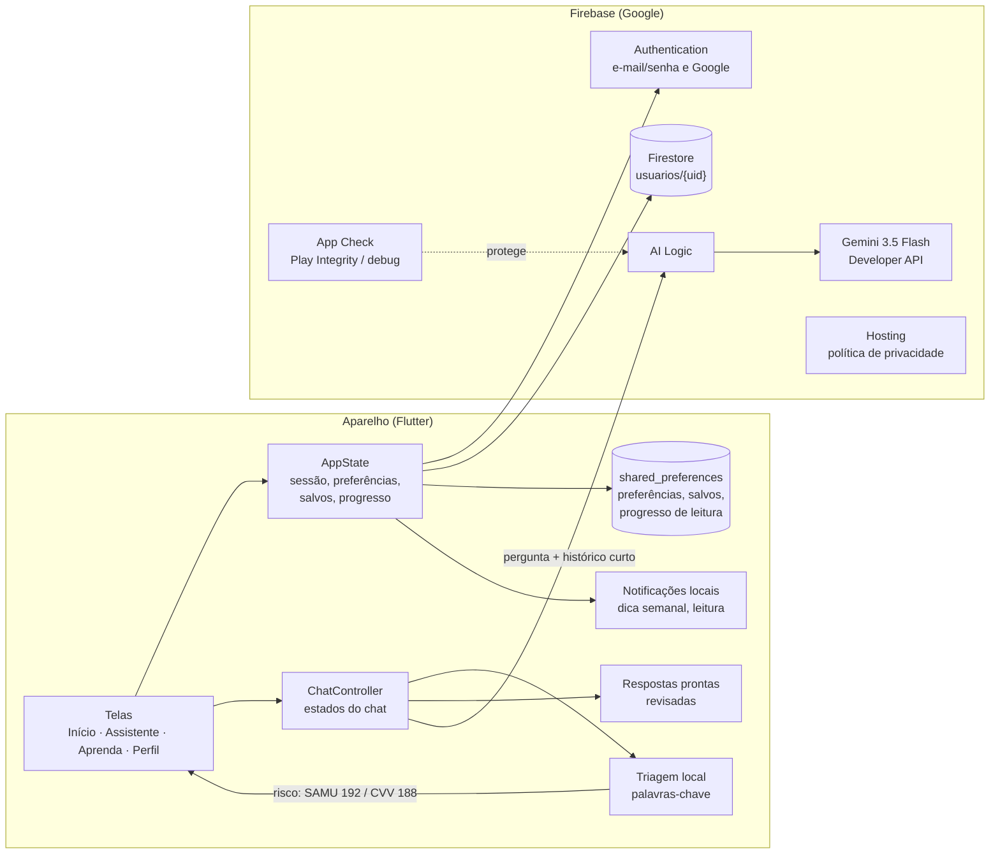

# CuidaIA: arquitetura e limitações

Material de apoio para o capítulo de desenvolvimento do TCC.

## Visão geral

O CuidaIA é um app Flutter (Android, com web e iOS possíveis) com backend 100%
gerenciado no Firebase, plano Spark (gratuito). Não há servidor próprio.

## Caminho de uma pergunta no assistente

1. **Triagem local** (`lib/data/triagem.dart`). Palavras de risco (dor no
   peito, falta de ar, ideação suicida...) mostram na hora o SAMU 192 ou o CVV
   188. Essas perguntas **nunca** vão para a IA e funcionam mesmo sem internet.
   Pedidos curtos de orientação ("onde devo ir?") abrem o fluxo de perguntas
   "Onde devo ser atendido?".
2. **Respostas prontas.** As perguntas sugeridas têm texto revisado e não
   gastam cota.
3. **Gemini** (`lib/data/assistente_gemini.dart`). As demais perguntas vão com
   as últimas 6 trocas, para entender continuações. A instrução de sistema fica
   em `lib/data/instrucoes_assistente.dart`. O modelo devolve **JSON com
   esquema fixo**:
   - `paragrafos`: de 1 a 4;
   - `fonte`: uma chave de uma lista fechada de documentos oficiais;
   - `nivel`: o nível de atenção sugerido;
   - `justificativa`;
   - `oferecerOrientacao`.

   Como o link sai da lista do app, **a IA não consegue inventar uma URL**.
   Fonte desconhecida vira o portal do Ministério da Saúde.
4. **Falhas** (rede, cota, tempo limite de 40 s, JSON inválido) mostram um
   aviso com "Tentar de novo", e a conversa continua.

Parâmetros: temperatura 0,3, raciocínio do modelo em nível baixo e até 4096
tokens de saída. O raciocínio conta dentro desse limite; com 1024, as respostas
saíam cortadas.

## Dados e privacidade (LGPD)

| Dado | Onde fica | Quem acessa |
|---|---|---|
| Login (e-mail/senha ou Google) | Firebase Authentication | só a própria pessoa |
| Perfil: nome, apelido, e-mail, foto ≤ 300 KB | Firestore `usuarios/{uid}` | só a própria pessoa (`firestore.rules`) |
| Preferências, salvos, progresso de leitura | aparelho | só o aparelho |
| Conversas | memória do aparelho; apagadas ao sair | só o aparelho |
| Texto das perguntas livres | enviado ao Gemini, sem nome nem e-mail | Google (plano gratuito pode usar para melhorar serviços) |

Direitos do titular implementados no app (Perfil > Meus dados):
- ver os dados;
- baixar uma cópia em JSON (portabilidade);
- corrigir o perfil;
- excluir a conta, o que apaga o login, o perfil e os dados locais.

As regras do Firestore negam qualquer acesso fora de `usuarios/{uid}` e
validam campos e tamanhos.

## Segurança

- **Nenhuma chave de API no app.** O AI Logic faz a ponte com o Gemini.
- **App Check** garante que só o app verdadeiro gasta a cota da IA: Play
  Integrity no Android publicado, token de depuração em desenvolvimento.
- A chave de assinatura e o token de depuração ficam fora do git.

## Testes e avaliação

- `flutter test`: 31 testes cobrindo:
  - login (e-mail e Google), validação, recuperação de senha e exclusão de conta;
  - notificações;
  - progresso de leitura;
  - triagem;
  - conversão do JSON do Gemini;
  - estados do chat e o botão do mapa.
- `tool/avaliar_cenarios.dart` com `avaliacao/cenarios.csv` mede se o nível
  sugerido bate com o gabarito. Ele roda a mesma triagem e a mesma
  configuração do modelo e mede acurácia, matriz de confusão e **subtriagem**
  (urgência classificada como outro nível). Veja `avaliacao/README.md`.

## Limitações

1. **Não é triagem clínica.** A triagem local é por palavras-chave: pega
   frases comuns de risco, mas pode deixar passar uma descrição incomum, com
   erro de digitação ou indireta. O app sempre lembra do 192, mas não substitui
   protocolos como o de Manchester.
2. **A IA pode errar.** Mesmo com esquema fixo, fontes fechadas e temperatura
   baixa, o texto dos parágrafos é gerado e pode conter imprecisões. A
   avaliação por cenários mede isso, mas com uma amostra pequena. O gabarito
   final precisa de revisão por profissional de saúde.
3. **Cota gratuita.** O plano gratuito do Gemini tem limite de requisições por
   minuto e por dia. Com muitos usuários, o assistente passaria a responder com
   erro; o resto do app continua funcionando.
4. **Privacidade no plano gratuito.** O Google pode usar o texto das perguntas
   para melhorar os próprios serviços. Isso é avisado na política e no chat.
   Para evitar, seria preciso migrar para a Vertex AI (plano Blaze, pago).
5. **Unidades próximas dependem do app de mapas.** O botão "Ver unidades perto
   de mim" abre o app de mapas do celular buscando o tipo de serviço (UBS, UPA,
   CAPS). Assim o CuidaIA não precisa pedir nem guardar a localização. Em
   compensação, os resultados vêm da busca do mapa e não de um cadastro oficial
   (CNES): podem aparecer unidades privadas, e o horário e o funcionamento
   precisam ser conferidos.
6. **Conteúdo com data.** Os artigos citam normas (Portaria 4.279/2010, PNAB,
   etc.) e precisam de revisão periódica. A data fica na tela Aprenda.
7. **Conversas não ficam salvas.** É uma escolha de privacidade, mas a pessoa
   perde o histórico ao sair da conta.
8. **Web e iOS.** A versão web está publicada (Firebase Hosting), mas sem
   notificações, que dependem do Android. O iOS compila, mas não foi testado.
